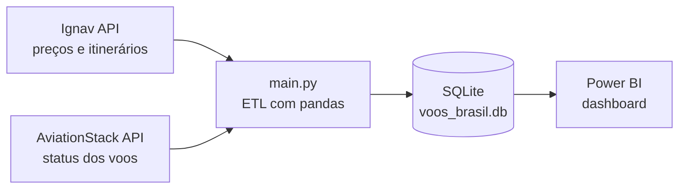

# ✈️ Análise de Voos no Brasil — Big Data em Python


Projeto de ETL em Python focado em **quem vai comprar passagem**: coleta preços de passagens e status de voos no Brasil, grava tudo em SQLite e alimenta um relatório no Power BI.

O foco é responder o que quem vai comprar passagem quer saber:

- Qual é a opção **mais barata** para a minha rota e a minha data?
- Em que **horário** o voo sai e chega? Tem **escala**? Onde?
- A conexão é em **bilhetes separados** (mais risco)?
- Quanto tempo de viagem? Chega só no dia seguinte?
- Com quantos **dias de antecedência** costuma compensar comprar?

---

## 🧱 Como funciona



| Etapa | O que acontece |
|---|---|
| **Extract** | `extract/ignav.py` e `extract/aviationstack.py` consultam as APIs |
| **Transform** | Os dados viram colunas prontas para análise: período do dia, duração em `5h35`, escalas, preço formatado, dias de antecedência, textos em português |
| **Load** | `main.py` grava tudo no SQLite (`voos_brasil.db`) |
| **Visualize** | O Power BI lê o banco, principalmente a view `vw_passagens_atuais` |

## 🗂️ Fontes de dados

| Fonte | O que traz | Limite do plano grátis |
|---|---|---|
| [Ignav](https://ignav.com/docs/one-way) | Preços, horários, escalas e duração | 1.000 requisições, **uso único** (não renova) |
| [AviationStack](https://aviationstack.com/documentation) | Status dos voos (programado, cancelado...) e rotas | 100 requisições por mês |

## 🚀 Como rodar (VS Code)

**Pré-requisitos:** Python 3.10+ e chaves de API da [Ignav](https://ignav.com) e da [AviationStack](https://aviationstack.com).

1. Abra a pasta do projeto no VS Code.
2. Crie e ative um ambiente virtual:
   ```bash
   python -m venv venv
   # Windows:
   venv\Scripts\activate
   # macOS/Linux:
   source venv/bin/activate
   ```
3. Instale as dependências:
   ```bash
   pip install -r requirements.txt
   ```
4. Crie o arquivo `.env` a partir do modelo e preencha as chaves da AviationStack e da Ignav:
   ```bash
   # Windows:
   copy .env.example .env
   # macOS/Linux:
   cp .env.example .env
   ```
   **Não suba o `.env` pro GitHub** (já está no `.gitignore`).
5. Crie o banco de dados (só precisa rodar uma vez):
   ```bash
   python db/init_db.py
   ```
   Se você já tinha um `voos_brasil.db` de uma versão anterior, use `python db/init_db.py --recriar` (as colunas mudaram).
6. Rode a coleta:
   ```bash
   python main.py
   ```

Isso vai popular `voos_brasil.db` (SQLite) com os dados das duas fontes. Rodando o `main.py` periodicamente (ex: 1x por dia, manualmente ou via Agendador de Tarefas / cron), você acumula histórico ao longo do tempo.

### ⚙️ Personalização

No `main.py`:

- `ROTAS_PRECO`: rotas consultadas na Ignav (origem e destino em código IATA)
- `DATA_PARTIDA_PRECO`: data do voo pesquisada (use uma data futura)
- `AEROPORTOS_AVIATIONSTACK`: aeroportos consultados no AviationStack

## 📁 Estrutura

```
analise-voos-brasil/
├── .env.example               # modelo das chaves de API
├── .gitignore
├── requirements.txt
├── main.py                    # orquestra a coleta e grava no SQLite
├── db/
│   ├── schema.sql             # tabelas e view
│   └── init_db.py             # cria o banco + popula aeroportos
├── extract/
│   ├── aviationstack.py       # status dos voos
│   └── ignav.py               # preços e detalhes da passagem
└── voos_brasil.db             # criado após rodar init_db.py
```

## 📊 Modelo de dados

**`precos`**: cada linha é uma opção de passagem encontrada.

| Coluna | Descrição |
|---|---|
| `origem`, `destino`, `data_partida` | Rota e data do voo |
| `dias_antecedencia` | Quantos dias antes do voo o preço foi coletado |
| `dia_semana_partida` | Dia da semana da partida |
| `companhia_nome`, `numero_voo` | Companhia e voo (conexões: `LA3040 + LA2100`) |
| `cabin_class` | Classe: Econômica, Econômica Premium, Executiva ou Primeira Classe |
| `horario_partida`, `horario_chegada` | Hora local (`HH:MM`) |
| `periodo_partida` | Madrugada, Manhã, Tarde ou Noite |
| `chegada_dia_seguinte` | `1` se chega no dia seguinte |
| `numero_escalas`, `aeroportos_escala` | Quantidade e aeroportos das escalas |
| `duracao_min`, `duracao_formatada` | Duração total (por exemplo, `5h35`) |
| `bilhetes_separados` | `Sim` = conexão em bilhetes separados (mais risco) |
| `preco`, `preco_formatado`, `moeda` | Valor e texto pronto (`R$ 2.387,00`) |
| `status_preco` | Situação do preço (por exemplo, `Verificado`) |

**`voos_status`**: número do voo, companhia, origem, destino, horário previsto de partida e chegada, status (`Programado`, `Em voo`, `Pousou`, `Cancelado`, `Incidente` ou `Desviado`), duração e dia da semana.

**Apoio**: `aeroportos`, `companhias`, `resumo_rotas`.

**View `vw_passagens_atuais`**: só a coleta mais recente de cada rota e data, ordenada do mais barato.

## 📈 Conectando ao Power BI

No Power BI Desktop, vá em **Página Inicial → Obter dados → Mais… → Outros → Script do Python** e use:

```python
import sqlite3
import pandas as pd

conn = sqlite3.connect(r"C:\caminho\para\analise-voos-brasil\voos_brasil.db")

passagens = pd.read_sql("SELECT * FROM vw_passagens_atuais", conn)
voos_status = pd.read_sql("SELECT * FROM voos_status", conn)
aeroportos = pd.read_sql("SELECT * FROM aeroportos", conn)

conn.close()
```

> **Preço aparecendo 10x maior (`8560` em vez de `856`)?**
> O Power BI em português lê o ponto decimal como separador de milhar. O script acima já converte o `preco` para reais inteiros. Para exibir o valor formatado, use também a coluna `preco_formatado` (texto pronto).

### 🔄 Atualizando os dados

1. Rode `python main.py` para gravar uma coleta nova no banco.
2. No Power BI, clique em **Atualizar** (Página Inicial).

### Ideias de visuais

- Cartão com o menor preço da rota selecionada
- Barras com o preço médio por companhia ou por destino
- Linha com preço por dias de antecedência
- Matriz de preço por dia da semana e período do dia
- Tabela com as opções, filtrando por escalas e por bilhetes separados
- Participação das companhias por aeroporto (colunas 100% empilhadas)
- Faixas de preço em roscas ("abaixo de R$ 500", "R$ 500 a 999", "acima de R$ 1.000")

## ⚠️ Observações importantes

- **AviationStack**: o plano grátis tem só 100 requisições por mês e usa HTTP, sem HTTPS. O `main.py` já consulta poucos aeroportos por execução; ajuste a lista `AEROPORTOS_AVIATIONSTACK` conforme sua cota.
- **Ignav**: as 1.000 requisições grátis **não renovam mensalmente** (é uma cota única). Use com moderação, ideal para uma amostragem inicial de preços, não para coleta contínua e ilimitada.
- Preços são uma foto do momento da coleta e podem mudar ou esgotar na hora da compra.
- **Nunca suba o `.env` com suas chaves para o GitHub.** Ele já está no `.gitignore`.

## 👤 Autor

**Yan Augusto**, estudante de Ciência da Computação.