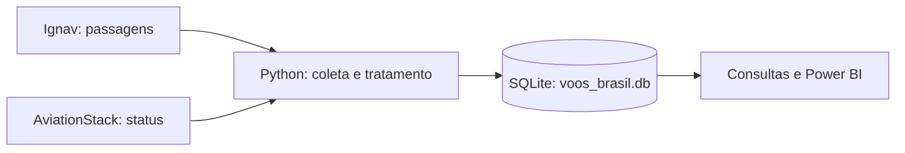

# ✈️ Análise de Voos no Brasil

Projeto em Python para coletar **preços de passagens** e **status de voos**, guardar essas informações em um banco SQLite e explorá-las com pandas ou Power BI.

A ideia é facilitar perguntas como: quais rotas têm os menores preços, quanto tempo dura a viagem, se há escalas e como os valores variam conforme a antecedência da compra.

## O que o projeto faz

1. **Coleta:** consulta a Ignav (tarifas e itinerários) e a AviationStack (situação dos voos).
2. **Organiza:** transforma as respostas das APIs em tabelas com colunas padronizadas.
3. **Armazena:** acrescenta os resultados ao arquivo `voos_brasil.db` usando SQLite.
4. **Permite analisar:** disponibiliza uma view com as tarifas mais recentes para consulta e visualização.



O projeto **não compra passagens nem emite bilhetes**. Os preços são registros do momento da consulta e podem mudar.

## Tecnologias

- **Python 3.10 ou superior:** executa os scripts.
- **requests:** faz as chamadas HTTP às APIs.
- **pandas:** organiza os dados das respostas.
- **python-dotenv:** carrega as chaves do arquivo `.env`.
- **SQLite:** banco local, sem necessidade de instalar um servidor.
- **matplotlib:** incluído nas dependências para análises e gráficos complementares.
- **Power BI (opcional):** cria visualizações a partir das tabelas do banco.

## Como executar

### 1. Preparar o ambiente

Na pasta `Analise-de-voos`, abra o terminal e crie um ambiente virtual:

```bash
python -m venv venv
```

Ative o ambiente conforme o sistema operacional:

| Sistema | Comando |
|---|---|
| Windows (PowerShell) | `.\venv\Scripts\Activate.ps1` |
| Windows (Prompt de Comando) | `venv\Scripts\activate.bat` |
| Linux/macOS | `source venv/bin/activate` |

Depois, instale as bibliotecas:

```bash
python -m pip install -r requirements.txt
```

> Se o Windows não reconhecer `python`, verifique a instalação ou tente `py`. Se o PowerShell bloquear a ativação, você pode usar o Prompt de Comando.

### 2. Configurar as chaves das APIs

São necessárias contas e chaves válidas para usar as consultas online:

- [Ignav — documentação](https://ignav.com/docs/one-way): preços, itinerários, escalas e horários.
- [AviationStack — documentação](https://aviationstack.com/documentation): situação e horários previstos dos voos.

Crie um arquivo `.env` a partir do **`.env.example` incluído no projeto**:

```powershell
# Windows (PowerShell)
Copy-Item .env.example .env
```

```bash
# Linux/macOS
cp .env.example .env
```

Abra `.env` e preencha suas próprias chaves:

```dotenv
AVIATIONSTACK_API_KEY=sua_chave_aviationstack_aqui
IGNAV_API_KEY=sua_chave_ignav_aqui
```

**Importante:** o arquivo `.env` está no `.gitignore`; não compartilhe as credenciais no repositório ou em arquivos ZIP. O `.env.example` é apenas um modelo, sem segredos.

### 3. Verificar ou preparar o banco

O pacote pode incluir um `voos_brasil.db` com dados já coletados. Se esse arquivo estiver presente e for válido, **não é necessário recriá-lo** para consultar os registros.

Se estiver começando do zero, use:

```bash
python db/init_db.py
```

Esse comando cria as tabelas e cadastra os aeroportos iniciais, sem apagar o histórico existente. Há também a opção abaixo, mas use **somente se quiser perder todos os registros atuais**:

```bash
python db/init_db.py --recriar
```

### 4. Ajustar as consultas e executar

No início de `main.py`, revise:

| Configuração | Para que serve |
|---|---|
| `AEROPORTOS_AVIATIONSTACK` | Aeroportos de partida consultados na AviationStack (códigos IATA) |
| `ROTAS_PRECO` | Pares de origem e destino pesquisados na Ignav |
| `DATA_PARTIDA_PRECO` | Data da passagem desejada, no formato `AAAA-MM-DD` |

A configuração original usa uma **data fixa**. Atualize-a quando quiser buscar outra data de viagem; não há ajuste automático para o dia atual.

Para executar a coleta:

```bash
python main.py
```

O terminal mostra quantos voos ou tarifas foram gravados em cada consulta. Um erro em um aeroporto ou rota é informado no terminal, e as próximas consultas continuam.

**Atenção às cotas:** cada aeroporto e cada rota configurados representam chamadas às respectivas APIs. Confira no painel dos fornecedores os limites disponíveis no seu plano antes de repetir a coleta.

**Conexão AviationStack:** a URL atualmente configurada em `extract/aviationstack.py` utiliza HTTP. Isso não protege a chave em trânsito; confirme no seu plano se há uma opção HTTPS antes de executar em redes não confiáveis. A URL não foi modificada nesta revisão para preservar a integração existente.

## Organização das pastas

```text
Analise-de-voos/
├── main.py                      # coordena a coleta e grava no SQLite
├── README.md                    # este guia
├── requirements.txt             # bibliotecas Python
├── .env.example                 # modelo para as chaves de API
├── .gitignore                   # arquivos locais fora do Git
├── common/
│   └── common/
│       └── aeroportos.py       # catálogo auxiliar e cálculo de distância
├── db/
│   ├── init_db.py              # cria o banco e cadastra aeroportos
│   └── schema.sql              # estrutura das tabelas e da view
├── extract/
│   ├── aviationstack.py        # busca e trata status de voos
│   └── ignav.py                # busca e trata preços de passagens
├── tests/
│   └── test_pipeline.py        # testes locais, sem acesso às APIs
└── voos_brasil.db               # banco local (se incluído ou inicializado)
```

`venv/` e `.env` são arquivos locais, não fazem parte do pacote distribuído. O banco `.db` é ignorado pelo Git, mesmo que uma cópia seja enviada à equipe separadamente.

**Para atualizar o catálogo de aeroportos:** a inicialização usa a lista de `db/init_db.py`. O arquivo `common/common/aeroportos.py` mantém um catálogo auxiliar para cálculos e não atualiza automaticamente a tabela do banco.

## O que existe no banco de dados

| Tabela ou view | Conteúdo |
|---|---|
| `aeroportos` | Códigos IATA, nomes, cidades e coordenadas |
| `companhias` | Cadastro de companhias aéreas (pode estar vazio) |
| `voos_status` | Voos consultados na AviationStack e seus status |
| `precos` | Opções de passagens, preços, datas e escalas |
| `resumo_rotas` | Estrutura de apoio para resumos por rota (não preenchida pela coleta atual) |
| `vw_passagens_atuais` | Opções da coleta mais recente por origem, destino e data de viagem |

Na tabela `precos`, alguns campos úteis são `preco` (número para cálculos), `preco_formatado` (texto para exibição), `dias_antecedencia`, `numero_escalas`, `duracao_min`, `duracao_formatada`, `bilhetes_separados`, `horario_partida` e `horario_chegada`.

**Não confunda as duas tabelas de voos:** `voos_status` descreve a situação de voos monitorados; `precos` descreve opções de passagens encontradas nas buscas. Elas vêm de fontes diferentes.

### Consulta rápida com Python

Abra um terminal na pasta do projeto e execute este exemplo em um arquivo Python ou em um notebook:

```python
import sqlite3
import pandas as pd

conn = sqlite3.connect("voos_brasil.db")
passagens = pd.read_sql_query("SELECT * FROM vw_passagens_atuais", conn)
conn.close()

print(passagens.head())
```

## Usando no Power BI

No Power BI Desktop, abra **Página Inicial → Obter dados → Mais → Script do Python**. Ajuste o caminho para a pasta do projeto **no seu próprio computador**:

```python
import sqlite3
import pandas as pd

# Substitua pelo caminho real do arquivo no seu computador.
caminho_banco = r"C:\CAMINHO\Analise-de-voos\voos_brasil.db"

conn = sqlite3.connect(caminho_banco)
passagens = pd.read_sql_query("SELECT * FROM vw_passagens_atuais", conn)
voos_status = pd.read_sql_query("SELECT * FROM voos_status", conn)
aeroportos = pd.read_sql_query("SELECT * FROM aeroportos", conn)
conn.close()
```

Selecione as tabelas exibidas pelo Power BI e configure os visuais desejados. Para trazer uma coleta nova, execute `python main.py` e depois use **Atualizar** no Power BI.

**Se o preço aparecer multiplicado ou com casas decimais erradas**, confira o tipo da coluna `preco` e a configuração regional de separadores decimais no Power BI. O script acima **não converte nem corrige automaticamente** os valores. Use `preco_formatado` quando precisar de um texto já formatado, mas prefira `preco` para calcular médias e mínimos.

Sugestões de análises: menor tarifa por rota, preço médio por companhia, distribuição por número de escalas e valores por dias de antecedência.

## Testando antes de compartilhar

Os testes incluídos usam respostas simuladas das APIs, sem consumir a cota das contas. Com as dependências instaladas, execute:

```bash
python -m unittest discover -s tests -v
```

Eles verificam a conversão de preços e status, os parâmetros das requisições e a preparação de um banco temporário. **Não são um substituto para testar as APIs com credenciais reais**, que dependem da rede, do plano e da disponibilidade de cada serviço.

## Problemas comuns

- **`ModuleNotFoundError`:** verifique se o ambiente virtual está ativado e execute `python -m pip install -r requirements.txt`.
- **`KeyError: 'IGNAV_API_KEY'` ou `'AVIATIONSTACK_API_KEY'`:** confira os nomes das variáveis no `.env` e se o comando está sendo executado na pasta do projeto.
- **`Banco nao encontrado`:** execute `python db/init_db.py` antes de `python main.py`.
- **API sem resultados:** confira as datas, os aeroportos, as cotas e os avisos retornados pelo provedor. Nem toda rota ou data terá tarifas disponíveis.
- **Power BI não encontra o banco:** ajuste `caminho_banco` para o local real do seu arquivo `.db`.

## Cuidados para trabalhar em equipe

- Mantenha os nomes das colunas e a estrutura SQLite compatíveis com as consultas existentes.
- Não publique `.env`, chaves de API nem a pasta `venv/`.
- Evite `--recriar` se houver dados que precisam ser mantidos.
- Rode os testes depois de editar a transformação das APIs.
- Como `voos_brasil.db` é ignorado pelo Git, combine com a equipe como compartilhar uma cópia do banco quando necessário.